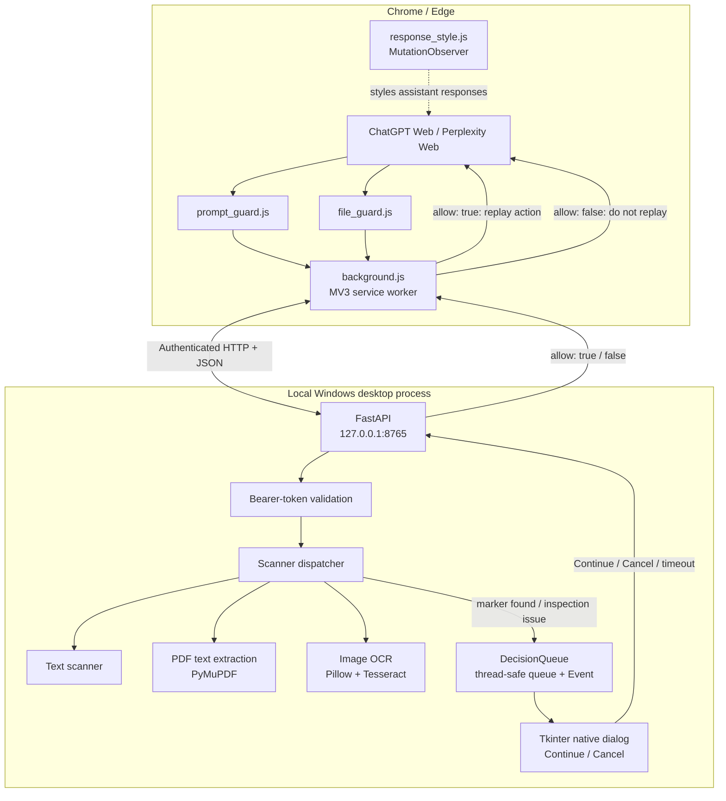
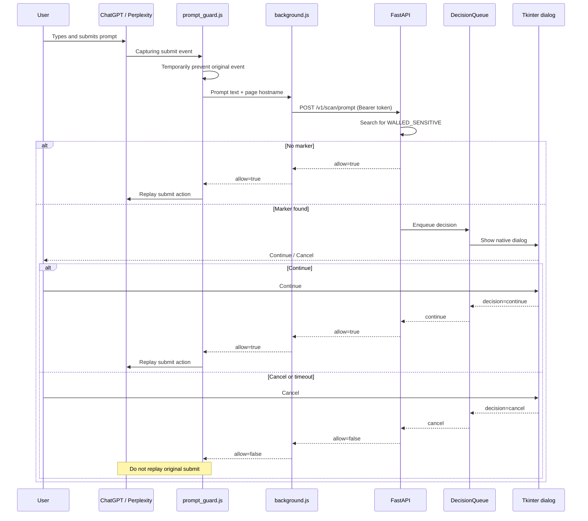
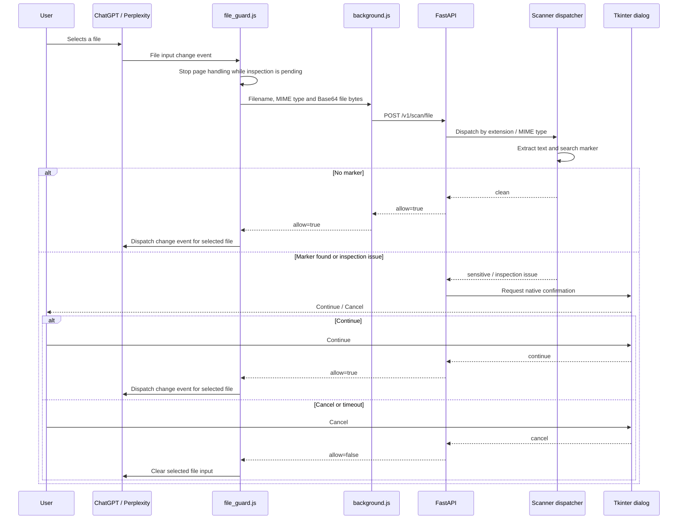

# Walled DLP — Architecture Overview

## 1. System context

Walled DLP is a local desktop DLP prototype for ChatGPT Web and Perplexity Web. It combines a browser extension with a Python desktop application.

The extension observes supported prompt submission and file-selection events. It sends content to a local FastAPI service. When `WALLED_SENSITIVE` is found, the API waits for a user decision delivered through a native Tkinter dialog. A separate content script recolors detected AI response containers.

## 2. Architecture diagram



## 3. Component responsibilities

### Browser extension

| File | Responsibility |
|---|---|
| `extension/manifest.json` | Manifest V3 metadata, permissions, host access and content-script injection |
| `extension/background.js` | Receives content-script messages and calls the authenticated local API |
| `extension/popup.html`, `popup.js` | Saves the local API bearer token in extension storage |
| `extension/content/common.js` | Shared page helpers, composer text extraction and message construction |
| `extension/content/prompt_guard.js` | Intercepts supported Enter and Send-button prompt submission paths |
| `extension/content/file_guard.js` | Intercepts file-input `change` events and delays page handling until inspection completes |
| `extension/content/response_style.js` | Watches DOM changes and applies the response-color class |
| `extension/sites/chatgpt.js` | ChatGPT-specific assistant response selectors |
| `extension/sites/perplexity.js` | Perplexity-specific assistant response selectors |
| `extension/styles/response.css` | Shared response-color CSS |

### Python desktop application

| File | Responsibility |
|---|---|
| `app/main.py` | Configures logging, starts FastAPI in a background thread and runs the Tkinter event loop |
| `app/config.py` | Marker, loopback host, port, file-size limit, token and log paths |
| `app/server.py` | Authenticated prompt and file scan endpoints |
| `app/decision_queue.py` | Thread-safe queue; each request waits on its own event |
| `app/dialog.py` | Native Continue/Cancel confirmation dialog |
| `app/logging_setup.py` | Rotating local application logs |
| `app/scanners/base.py` | Shared scan-result model |
| `app/scanners/text_scanner.py` | Case-insensitive marker search in decoded text |
| `app/scanners/pdf_scanner.py` | Extracts embedded PDF text using PyMuPDF |
| `app/scanners/image_scanner.py` | Extracts image text using Pillow and Tesseract OCR |
| `app/scanners/dispatcher.py` | Selects a scanner by extension and MIME type |

## 4. Prompt inspection sequence



## 5. File inspection sequence



## 6. Response recoloring

1. `response_style.js` reads `responseSelectors` from `window.WALLED_DLP_SITE`.
2. It finds matching assistant response containers and adds `walled-dlp-ai-response`.
3. A `MutationObserver` repeats this when response DOM nodes are added.
4. CSS changes response text to `#16803c`.
5. User prompt containers are not targeted.

Selectors are site-specific because ChatGPT and Perplexity use different DOM structures. They depend on website markup and may need maintenance.

## 7. Local API contract

### `GET /health`

Returns a basic health status for local connectivity checks.

### `POST /v1/scan/prompt`

Required header: `Authorization: Bearer <local-token>`

Example request:

```json
{
  "text": "Example prompt containing WALLED_SENSITIVE",
  "page": "chatgpt.com"
}
```

Example response:

```json
{
  "allow": false,
  "sensitive": true
}
```

### `POST /v1/scan/file`

Required header: `Authorization: Bearer <local-token>`

Example request:

```json
{
  "filename": "marked.txt",
  "mime_type": "text/plain",
  "data_base64": "<base64-encoded-file-bytes>",
  "page": "chatgpt.com"
}
```

The service enforces the configured maximum file size before scanning.

## 8. Trust boundaries and security controls

- The API binds to `127.0.0.1`, not all network interfaces.
- Scan endpoints require a random bearer token stored in the user's local application-data directory and browser extension storage.
- Scanning runs locally; content is not sent to an external scanning service.
- Application logs are intended to record operational metadata rather than prompt/file contents.
- If the local API cannot be reached, the extension does not replay the intercepted action.
- The decision queue serializes dialogs and uses per-request events.
- The configured file-size limit limits accepted payload size.

## 9. Known limitations and trade-offs

1. **Dynamic websites:** DOM selectors and event handling can break when ChatGPT or Perplexity changes its frontend.
2. **Upload coverage:** Current file handling intercepts file-input `change` events. Drag-and-drop, clipboard paste and all alternate upload routes are not comprehensively intercepted.
3. **Scanned PDFs:** PyMuPDF extracts embedded text. Image-only PDFs do not receive OCR in this implementation and are sent to the confirmation flow as an inspection issue.
4. **OCR accuracy:** Tesseract can miss text in low-resolution, rotated, obscured or unusual-font images.
5. **Submit replay:** Website submit controls and keyboard behavior can change; regression-test after site updates.
6. **Local token:** Protect the Windows user account and never publish the token.
7. **Single-user design:** Tkinter and the local API are designed for one interactive desktop session.
8. **Prototype scope:** This is an assignment implementation, not a certified enterprise DLP product.

## 10. Future improvements

- Add drag-and-drop and clipboard upload interception.
- Add OCR for scanned/image-only PDFs.
- Add configurable markers and regular-expression policies.
- Add token rotation and stronger extension/API pairing.
- Add browser automation tests against controlled pages.
- Add a packaged Windows installer and background lifecycle management.
