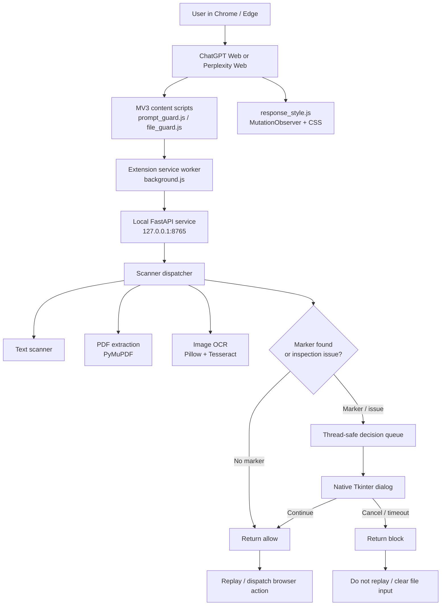
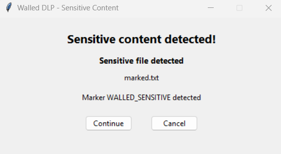
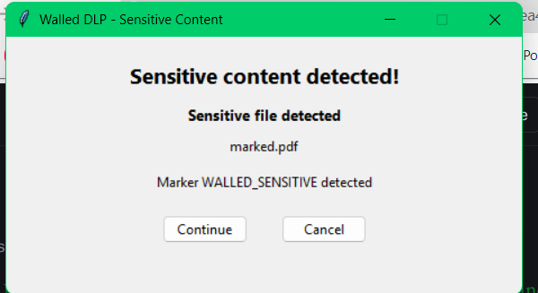
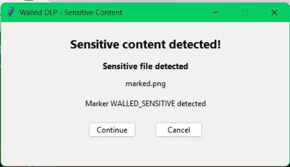

# Walled DLP

A lightweight desktop Data Loss Prevention (DLP) prototype for ChatGPT Web and Perplexity Web.

Walled DLP inspects supported outgoing prompts and selected file uploads for the predefined marker `WALLED_SENSITIVE`. When detected, it pauses the browser action and asks the user to Continue or Cancel in a native Windows desktop dialog. It also recolors detected AI-generated responses.

> **Status:** Assignment prototype. Prompt/file inspection, native approval and response recoloring have been manually demonstrated on ChatGPT and Perplexity. Website markup and upload flows can change; repeat the test plan before relying on a browser update.

## Features

- Prompt inspection on ChatGPT and Perplexity.
- Text file inspection (`.txt`, `.md`, `.csv`, `.json`, `.log`, and `text/*` MIME types).
- Text-based PDF extraction using PyMuPDF.
- Image OCR using Pillow, pytesseract and Tesseract OCR.
- Case-insensitive search for `WALLED_SENSITIVE`.
- Native Tkinter Continue/Cancel dialog.
- Continue allows the intercepted action to proceed; Cancel prevents it from being replayed.
- Response text recoloring using site-specific selectors and a `MutationObserver`.
- Local API bound to `127.0.0.1`, protected by a generated bearer token.
- Local logging designed not to record prompt or file contents.

## Architecture at a glance



See [ARCHITECTURE.md](ARCHITECTURE.md) for detailed component responsibilities, sequence diagrams, API contract, trust boundaries and limitations.

## Technology stack

| Layer | Technology |
|---|---|
| Browser integration | Chrome/Edge Extension, Manifest V3 |
| Content scripts | JavaScript |
| Local inspection API | Python, FastAPI, Uvicorn |
| Native confirmation dialog | Tkinter |
| Text inspection | Python string matching |
| PDF extraction | PyMuPDF |
| Image OCR | Pillow, pytesseract, Tesseract OCR |
| Validation | Pydantic |
| Tests | pytest, FastAPI TestClient |

## Requirements

- Windows 10/11
- Python 3.12
- Google Chrome or Microsoft Edge
- Tesseract OCR installed separately for image inspection

## Installation

### 1. Open the project

Clone/download the repository and open PowerShell in the project root (the directory containing `app`, `extension`, `requirements.txt` and `README.md`).

### 2. Create and activate a virtual environment

```powershell
py -3.12 -m venv .venv
.\.venv\Scripts\Activate.ps1
```

If PowerShell blocks activation, allow it for the current terminal only:

```powershell
Set-ExecutionPolicy -Scope Process -ExecutionPolicy Bypass
.\.venv\Scripts\Activate.ps1
```

### 3. Install Python dependencies

```powershell
python -m pip install --upgrade pip
pip install -r requirements.txt
```

### 4. Install Tesseract OCR

Install Tesseract OCR for Windows. A common executable path is:

```text
C:\Program Files\Tesseract-OCR\tesseract.exe
```

Verify:

```powershell
tesseract --version
```

If Tesseract is not on `PATH`, set its executable path in `app/scanners/image_scanner.py`:

```python
pytesseract.pytesseract.tesseract_cmd = (
    r"C:\Program Files\Tesseract-OCR\tesseract.exe"
)
```

Restart the desktop application after changing the path.

### 5. Start the desktop application

```powershell
python -m app.main
```

Keep the Python process and Walled DLP desktop window running. The API listens on `http://127.0.0.1:8765`.

Open `http://127.0.0.1:8765/health` to verify it. Expected response:

```json
{"status":"ok"}
```

A bearer token is generated and stored at:

```text
%LOCALAPPDATA%\WalledDLP\token.txt
```

### 6. Load the browser extension

1. Open `chrome://extensions` (Chrome) or `edge://extensions` (Edge).
2. Enable **Developer mode**.
3. Select **Load unpacked**.
4. Select the project's `extension` folder, not the project root.
5. Pin Walled DLP to the toolbar if desired.
6. Open the Walled DLP extension popup.
7. Copy the token from `%LOCALAPPDATA%\WalledDLP\token.txt`, paste it into the popup and click **Save token**.
8. After loading or reloading the extension, refresh existing ChatGPT and Perplexity tabs (Ctrl+Shift+R).

The extension service worker communicates with the local API. Scan endpoints require the bearer token.

## Run

```powershell
.\.venv\Scripts\Activate.ps1
python -m app.main
```

Keep the desktop application running while browsing. If the local API is unavailable, the extension is designed not to replay the intercepted action.

## Manual acceptance test plan

Run the following tests on **both ChatGPT and Perplexity**.

### Prompts

| Test | Example | Expected result |
|---|---|---|
| Clean prompt | `Explain REST APIs.` | Submitted without a dialog |
| Marked prompt | `This is confidential: WALLED_SENSITIVE` | Native dialog appears |
| Marked prompt + Cancel | Choose Cancel | Prompt stays in composer and is not submitted |
| Marked prompt + Continue | Choose Continue | Original prompt is submitted |

### Files

Generate samples:

```powershell
python scripts/make_samples.py
```

Samples are created in `tests/samples/`.

| Sample | Expected result |
|---|---|
| `clean.txt` | No dialog |
| `marked.txt` | Native dialog |
| `clean.pdf` | No dialog |
| `marked.pdf` | Native dialog |
| `clean.png` | No dialog (Tesseract required) |
| `marked.png` | Native dialog (Tesseract required) |

For each marked file, test both Continue and Cancel. Cancel should prevent the website from processing the selected file; Continue should allow the selected file to be processed.

### Response styling

1. Generate an AI response on ChatGPT and confirm response text is green (`#16803c`).
2. Confirm the user's own prompt retains its original color.
3. Repeat on Perplexity.
4. Generate another response to verify newly added response content is also styled.

## Automated tests

From the project root:

```powershell
pytest -q
```

The included tests cover basic text marker detection, API health and clean prompt handling, and decision queue timeout behavior. They do not replace manual end-to-end tests against the live websites.

## Project structure

```text
walled-dlp/
├── README.md
├── ARCHITECTURE.md
├── requirements.txt
├── pyproject.toml
├── app/
│   ├── main.py
│   ├── config.py
│   ├── server.py
│   ├── dialog.py
│   ├── decision_queue.py
│   ├── logging_setup.py
│   └── scanners/
│       ├── base.py
│       ├── text_scanner.py
│       ├── pdf_scanner.py
│       ├── image_scanner.py
│       └── dispatcher.py
├── extension/
│   ├── manifest.json
│   ├── background.js
│   ├── popup.html
│   ├── popup.js
│   ├── content/
│   │   ├── common.js
│   │   ├── prompt_guard.js
│   │   ├── file_guard.js
│   │   └── response_style.js
│   ├── sites/
│   │   ├── chatgpt.js
│   │   └── perplexity.js
│   └── styles/
│       └── response.css
├── tests/
│   ├── test_scanners.py
│   ├── test_server.py
│   ├── test_decision_queue.py
│   └── samples/
└── scripts/
    ├── make_samples.py
    ├── run.bat
    └── setup.bat
```

## Security considerations

- The API binds to `127.0.0.1`, not all network interfaces.
- Scan endpoints require a random bearer token generated locally.
- Prompt and file contents are not intentionally written to application logs; logs contain operational metadata and filenames.
- The API rejects files larger than the configured 12 MiB limit.
- If the local API cannot be reached, the extension does not replay the intercepted action.
- Inspection runs locally; content is not sent to a third-party scanning service.

## Known limitations

1. **Website DOM changes:** ChatGPT and Perplexity may change markup and event handling. Site-specific selectors and interception logic may need maintenance.
2. **Upload coverage:** Current file interception handles file-input `change` events. Drag-and-drop, clipboard paste and every alternate upload route are not comprehensively intercepted.
3. **Scanned PDFs:** The PDF scanner extracts embedded text with PyMuPDF. Image-only/scanned PDFs do not receive OCR in this implementation; they are treated as an inspection issue and sent to the confirmation flow.
4. **OCR accuracy:** Tesseract may miss text in low-resolution, rotated, obscured or unusual-font images.
5. **Prompt replay:** Website submit controls and keyboard behavior can change. Retest Enter and Send-button flows after site updates.
6. **Single-user prototype:** The local service and Tkinter dialog are designed for one interactive Windows desktop session.
7. **Not a certified DLP product:** This is a focused assignment prototype, not an enterprise endpoint security product.

## Troubleshooting

**Extension context invalidated:** This can happen if the extension is reloaded while a tab still has an older content script. Reload Walled DLP at `chrome://extensions` or `edge://extensions`, then refresh the website tab with Ctrl+Shift+R.

**Health endpoint does not respond:** Confirm `python -m app.main` is running and check the Python terminal for startup errors or a port conflict.

**Native dialog does not appear:** Confirm the desktop app is running, the extension popup has the current token saved, and the extension service worker console has no API errors.

**Tesseract missing:** Install Tesseract, verify `tesseract --version`, configure `pytesseract.pytesseract.tesseract_cmd` if needed, then restart the app.

## Screenshots

| Text file inspection | PDF inspection | Image OCR inspection |
|---|---|---|
|  |  |  |

